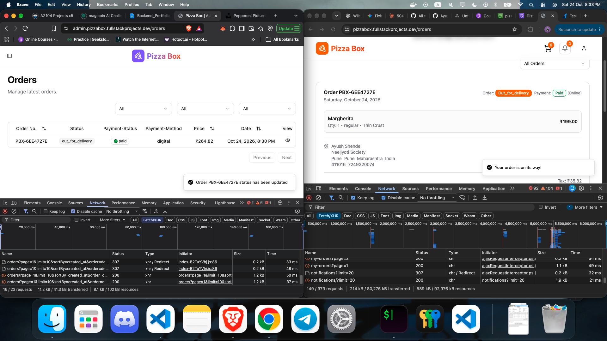

# Pizza Box — Customer App

The customer-facing storefront of **Pizza Box**, a full-stack pizza ordering platform. Customers can browse the menu, build custom pizzas, keep a cart as a guest, sign in, pay online (Razorpay) or on delivery, and follow their order in real time.

**Live:** <https://pizzabox.fullstackprojects.dev>

Built with **React 19**, **Vite**, **TypeScript**, **Tailwind CSS v4**, **shadcn/ui**, **React Router 7** and **TanStack Query**. Hosted as a static SPA on **S3 + CloudFront**.

---

## Table of contents

- [The Pizza Box ecosystem](#the-pizza-box-ecosystem)
- [Features](#features)
- [Tech stack](#tech-stack)
- [Architecture](#architecture)
- [Routes](#routes)
- [Getting started](#getting-started)
- [Environment variables](#environment-variables)
- [Scripts](#scripts)
- [Code quality](#code-quality)
- [Deployment](#deployment)

---

## The Pizza Box ecosystem

| Repository | Purpose | Live |
|---|---|---|
| [`pizza-box`](https://github.com/AyushShende25/pizza-box) | FastAPI REST/WebSocket backend, Celery worker | <https://api.pizzabox.fullstackprojects.dev> |
| **[`pizza-box-client`](https://github.com/AyushShende25/pizza-box-client)** *(this repo)* | Customer storefront | <https://pizzabox.fullstackprojects.dev> |
| [`pizza-box-admin`](https://github.com/AyushShende25/pizza-box-admin) | Admin dashboard | <https://admin.pizzabox.fullstackprojects.dev> |
| [`pizza-box-infra`](https://github.com/AyushShende25/pizza-box-infra) | Terraform, Helm & Argo CD (AWS) | — |

This app talks only to the backend API. To run it locally you need the API running too (see the [backend README](https://github.com/AyushShende25/pizza-box#getting-started)).

---

## Features

**Browsing & ordering**
- Landing page with hero, featured pizzas, feature highlights and testimonials
- Menu page with **infinite scroll**, debounced search by name, vegetarian / non-vegetarian filter and sorting (price, name, newest). Filters live in the URL query string, so views are shareable
- **Pizza customiser** (slide-over sheet): choose size and crust, see the pizza's default toppings, add extra veg/non-veg toppings, pick a quantity and see a live price before adding to cart
- **Cart for guests and members** — guest carts are stored server-side and tied to an HttpOnly cookie; on login the guest cart is **merged** into the account cart. Quantity changes are debounced; a navbar badge shows the item count
- **Checkout** with delivery-address picker, order notes and a choice of **Pay Online (UPI/Card via Razorpay)** or **Cash on Delivery**; the bill shows subtotal, delivery fee, tax and total as calculated by the server
- **My Orders** with infinite scroll and status filter (pending → delivered / cancelled), including per-order payment status and method
- **Address book** (up to 5 addresses, set default, delete) — also available inline during checkout

**Accounts & security**
- Register → **email verification** (check-email page with resend + 30 s cooldown) → login
- Forgot / reset password flow
- Session handled by HttpOnly cookies; expired access tokens are **refreshed transparently** and the failed request is retried
- Route guards: `ProtectedLayout` for account pages, `AuthLayout` bounces already-signed-in users away from login/register

**Real time**
- A WebSocket connection (opened when signed in, auto-reconnect every 3 s) pushes **order and payment updates**: toast messages appear instantly and the orders list and notification bell refresh automatically
- Notification dropdown with unread counter, per-item and "mark all as read"

**Polish**
- Skeleton loaders for cards, cart, options and order summary
- Global `ErrorBoundary` fallback and a 404 page
- Responsive, accessible UI built on Radix primitives

---

## Tech stack

| Area | Technology |
|---|---|
| UI | React 19, TypeScript 5.8 |
| Build tool | Vite 7 (`@vitejs/plugin-react`) |
| Styling | Tailwind CSS v4 (`@tailwindcss/vite`), `tw-animate-css`, shadcn/ui (*new-york* style) on Radix UI, `lucide-react` icons, `next-themes` (toast theming) |
| Routing | React Router 7 (declarative `BrowserRouter` with layout routes) |
| Server state | TanStack Query 5 (+ devtools), `infiniteQueryOptions` for paginated lists |
| Forms & validation | React Hook Form + Zod 4 (`@hookform/resolvers`) |
| HTTP | Axios (credentials enabled, 401-refresh interceptor) |
| Payments | Razorpay Checkout (script loaded on demand) |
| UX | Sonner toasts, `react-intersection-observer`, `react-error-boundary` |
| Tooling | Biome 2 (lint + format), Husky + lint-staged pre-commit hook |

---

## Architecture





## Routes

| Path | Layout | Access | Page |
|---|---|---|---|
| `/` | Default | Public | Home — hero, featured pizzas, features, testimonials |
| `/menu` | Default | Public | Menu with search, filters, sorting, infinite scroll |
| `/cart` | Default | Public (checkout requires login) | Cart & order summary |
| `/orders` | Default → Protected | 🔒 Signed-in | Order history & tracking |
| `/address` | Default → Protected | 🔒 Signed-in | Manage delivery addresses |
| `/login` · `/register` | Auth | Guests only | Authentication |
| `/check-email` | Auth | Guests only | "Verify your email" holding page (+ resend) |
| `/verify-email?token=` | Auth | Guests only | Consumes the emailed verification link |
| `/forgot-password` · `/reset-password?token=` | Auth | Guests only | Password recovery |
| `*` | — | — | 404 |

---

## Getting started

### Prerequisites

- **Node.js 20.19+** (Vite 7 requirement; CI builds with Node 24) and npm
- A running instance of the [Pizza Box API](https://github.com/AyushShende25/pizza-box) — locally on `http://localhost:8000`, or point at the hosted API
- A Razorpay **test** key id if you want to try online payments

### Install & run

```bash
git clone https://github.com/AyushShende25/pizza-box-client.git
cd pizza-box-client
npm install            # also installs the Husky git hook (via the `prepare` script)

cp .env.example .env   # then fill in the values below
npm run dev            # http://localhost:5173
```

> The backend allows CORS (with credentials) for `CLIENT_URL`, which defaults to `http://localhost:5173` — the Vite default port. If you change the dev port, update `CLIENT_URL` on the API too.

Handy local demo data: after seeding the API (`make seed`) you can sign in with the seeded customer accounts (e.g. `john.doe@gmail.com`) using the `SEED_USER_PASSWORD` you chose.

---

## Environment variables

Vite only exposes variables prefixed with `VITE_`. They are inlined **at build time**.

| Variable | Example (local) | Description |
|---|---|---|
| `VITE_PUBLIC_BACKEND_URL` | `http://localhost:8000/api/v1` | REST base URL — **must include the `/api/v1` prefix** |
| `VITE_PUBLIC_WS_URL` | `ws://localhost:8000/api/v1` | WebSocket base URL (`wss://` in production), also with the `/api/v1` prefix; the app appends `/notifications/ws` |
| `VITE_PUBLIC_RAZORPAY_KEY_ID` | `rzp_test_xxxxxxxx` | Razorpay **publishable** key id (never put the secret here) |


---

## Scripts

| Command | What it does |
|---|---|
| `npm run dev` | Start the Vite dev server with HMR |
| `npm run build` | Type-check (`tsc -b`) and create the production bundle in `dist/` |
| `npm run preview` | Serve the production build locally |
| `npm run lint` | Biome lint (with safe fixes) |
| `npm run format` | Biome format |
| `npm run check` | Biome lint + format + import organisation |

---

## Code quality

- **Biome** is the single linter/formatter (tabs, double quotes, organised imports).
- A **Husky pre-commit hook** runs `lint-staged`, which executes `biome check --write` on staged `*.{js,ts,tsx,jsx}` files.
- TypeScript runs in `strict` mode with `noUnusedLocals` / `noUnusedParameters`.

---

## Deployment

The app is a static bundle served from a **private S3 bucket through CloudFront** (Origin Access Control). CloudFront rewrites `403/404` to `/index.html` so client-side routes work on refresh. The infrastructure is defined in [`pizza-box-infra`](https://github.com/AyushShende25/pizza-box-infra).

**CI/CD** — `.github/workflows/deploy.yaml` runs on every push to `main` (or manually):

1. `npm ci` → `npm run build` with `VITE_PUBLIC_*` values injected from repository variables
2. Assume an AWS role via **GitHub OIDC** (no long-lived AWS keys)
3. `aws s3 sync dist/ s3://<bucket> --delete`
4. Invalidate the CloudFront distribution (`/*`)

Repository **variables** required:

| Variable | Description |
|---|---|
| `AWS_GITHUB_ACTIONS_ROLE_ARN` | IAM role to assume (`github-actions-client-ci`, created by Terraform) |
| `AWS_REGION` | e.g. `ap-south-1` |
| `S3_BUCKET_NAME` | Client bucket (`<domain>-client`) |
| `DISTRIBUTION_ID` | CloudFront distribution id for the client |
| `API_URL` | API host **and base path**, without scheme — e.g. `api.pizzabox.fullstackprojects.dev/api/v1` (the workflow prefixes `https://` / `wss://`) |
| `VITE_PUBLIC_RAZORPAY_KEY_ID` | Razorpay publishable key id |

Any static host works too — build with `npm run build` and serve `dist/` with an SPA fallback to `index.html`.

---


<sub>Part of the Pizza Box project — see [`pizza-box`](https://github.com/AyushShende25/pizza-box), [`pizza-box-admin`](https://github.com/AyushShende25/pizza-box-admin) and [`pizza-box-infra`](https://github.com/AyushShende25/pizza-box-infra).</sub>